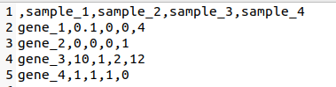
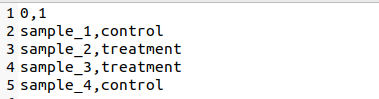
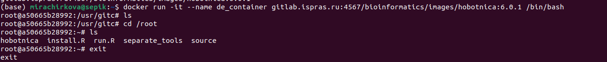
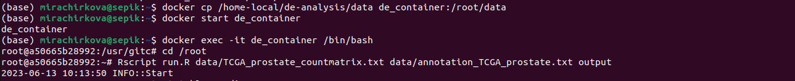
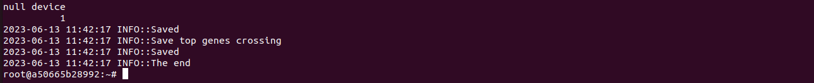
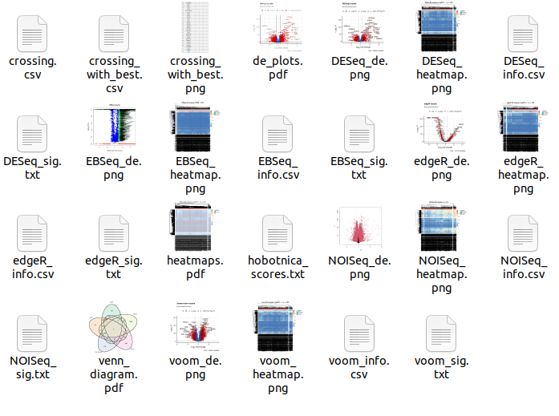

Comparing differential expression analysis tools with Hobotnica
--------------------------------------------------------------------------------------
---------------------------------------------------------------------------------------


Version: 7.0.1
------------

General usage notes
-------------------
- Program computes and visualizes gene-level RNA-seq differential expression
between two experimental conditions by 5 tools: DESeq, EBSeq, edgeR, 
limma voom and NOISeq. 
- Program also uses Hobotnica to compare results and calculate the best 
differential expression tool for input data. It also visualizes intersection 
of subsets.


------------
Docker container build instructions
-------------------
git clone git@gitlab.ispras.ru:bioinformatics/de-analysis.git
cd de-analysis
git submodule init
git submodule update
./docker_build.sh


----------------------------------------------------------------
Input data format
-----------------
Program uses matrix of un-normalized counts, table of annotation for 
each sample and name of directory for output.

The value in the i-th row and the j-th column of the count matrix tells 
how many reads (or fragments, for paired-end RNA-seq) can be assigned to 
gene i in sample j. Separator for values of matrix elements is ','. First 
column has no name. You can see an example in 
**'data/TCGA_prostate_countmatrix.txt'** file.

Table of annotation contains the sample name in the first column and 
the condition in the second. Separator for values of tables elements is ','.
Columns have names '0' and '1'. You can see an example in 
**'data/annotation_TCGA_prostate.txt'** file.


-----------------------------------------------------------------------------
Output data
-----------
Program gives several files for each tool as output. They all are in 
requested directory.

**'de_plots.pdf'** and **'heatmaps.pdf'** file contains visualisation of differential expression analysis.
Expressed genes are signed.

**'\*_sig.txt'** files contain lists of subsets for each tool corresponding 
chosen signature. Default signature is top-30 most expressed genes. You can manually change it by set "-n" option in run.R. Files 
names are **'DESeq_sig.txt'**, **'EBSeq_sig.txt'**, **'edgeR_sig.txt'**,
**'NOISeq_sig.txt'** and **'voom_sig.txt'**.

Program also plots Venn diagram that shows intersection of different tools 
subsets. File name is **'venn_diagram.pdf'**.

File **'crossing.csv'** contains table with information which tool count this gene as expressed.
 
File **'hobotnica_scores.txt'** contains results of Hobotnica computing 
for each tool.

File **'crossing_with_best.csv'** contains results of the best tool and its intersection with other tools results.  

Using "-s" option in run.R you can save this files:

- **'\*_res.rds'** files contain differential expression analysis results. They 
are different for each tool and might be of interest only for users who 
want to write their own R code with that results. Files names are 
**'DESeq_res.rds'**, **'EBSeq_res.rds'**, **'edgeR_res.rds'**, 
**'NOISeq_res.rds'** and **'voom_res.rds'**.

- **'\*_sig.txt.distmatrix'** files contain distance matrixes for each 
**'\*_sig.txt'** subset. Matrixes are ready to be used in Hobotnica. Files names are 
**'DESeq_sig.txt.distmatrix'**, **'EBSeq_sig.txt.distmatrix'**, 
**'edgeR_sig.txt.distmatrix'**, **'NOISeq_sig.txt.distmatrix'** and 
**'voom_sig.txt.distmatrix'**.

<!--

---------------------------------------------------------------------------

Quick start
------------
Download repository and change to the directory where this repository 
is stored. There are to ways to run program.
- **From your computer**

Type in command line this commands:

> **$ Rscript install.R**
> 
> **$ Rscript run.R countmatrix annotation output** 

Where **countmatrix** is matrix of un-normalized counts file name and 
**annotation** is table of annotation file name. **output** is a name
of directory for results.

- **From Docker**

Upload an image **diffexprimage** and start container **de_container**
(it automatically uses Dockerfile from repository):
> **$ docker pull gitlab.ispras.ru:4567/bioinformatics/images/hobotnica:7.0.1**
> 
> **$ docker run -it --name de_container gitlab.ispras.ru:4567/bioinformatics/images/hobotnica:7.0.1 /bin/bash"**
>
>**# exit**
>
Copy your input data to container. **countmatrix.txt** is matrix of 
un-normalized counts file name and **annotation.txt** is table of 
annotation file name.
> 
> **$ docker cp countmatrix.txt de_container:data/countmatrix.txt**
> 
> **$ docker cp annotation.txt de_container:data/annotation.txt**
>
Start work in container.
> **$ docker start de_container**
> 
> **$ docker exec -it de_container /bin/bash**
> 
Start work with program from Docker container.
> **/# Rscript run.R data/countmatrix.txt data/annotation.txt output**
>
where **output** is a name of directory for results.

Copy output to your computer.
>**docker cp de_container:output computer_output**
>
where **computer_output** is a directory for results.

-------------------------------------

Source files description
-----------------

- **install.R** \
Installs all required R packages.\
**Example**: 
`Rscript install.R`


- **run.R countmatrix annotation output [-s] [-n top]** \
Contains all the pipeline. It needs three command arguments - count 
matrix file name **countmatrix**, table **annotation** file name and output directory name **output**.\
Options:\
**-s** allows to save extra information (see output)\
**-n top** allows to set **top** number of genes in signature.\ 
See output of run.R in output data paragraph of readme.\
Imports functions from **source/DESeq.R**, **source/EBSeq.R**, 
**source/edgeR.R**, **source/NOISeq.R**, **source/voom.R**, 
**source/signatures_utils.R**, **source/calculate_distmatrix_utils.R** \
**Example**: \
`Rscript run.R data/TCGA_prostate_countmatrix.txt 
data/annotation_TCGA_prostate.txt ouput`

Other files were not made for executing and contain functions for different parts of the pipelines.

-->
-------------------------------------------------------------------------

Как пользоваться инструментом?
-------------------------------

1. **Какие данные нужны?**

На вход инструменту нужны аннотация и матрица экспрессии. Инструмент использует очень конкретный вид данных:
- матрица экспрессии должна содержать названия генов в первой колонке, названия образцов в первой строке. 
Колонка с названиями генов должна быть безымянной, элементы отделяться друг от друга запятой. 
Числа могут быть нецелыми, разделяющий символ -- точка. Привести матрицу экспрессии к такому виду можно с помощью манипуляций
в Excel или аналогах. Пример можно посмотреть в папке data или на рисунке ниже.


- аннотация должна содержать две колонки -- название образца и экспериментальную группу. Элементы должны раздеяться запятой. Первая строчка 
должна выглядеть, как '0,1'. Пример можно посмотреть в папке data или на рисунке ниже. 




2. **Как пользоваться контейнеризованным инструментом?**

Сейчас самая актуальная версия лежит в контейнере [gitlab.ispras.ru:4567/bioinformatics/images/hobotnica:7.0.1](gitlab.ispras.ru:4567/bioinformatics/images/hobotnica:7.0.1)

Поэтому все манипуляции будем проводить с ним. Перед тем, как пользоваться контейнером, нужно проверить, что на компьютер установлен Docker:
```
docker --help
```
Если команда вывела сообщение со списком доступных команд, то всё хорошо. Иначе следуйте этому [гайду](https://docs.docker.com/get-docker/).

Скачаем на компьютер нужное изображение. Для этого в начале зайдем в хранилище образов ИСПа.
```
docker pull gitlab.ispras.ru:4567/bioinformatics/images/hobotnica:7.0.1
```
Проверим его работу и дадим конкретной "версии" изображения имя.
```
docker run -it --name de_container gitlab.ispras.ru:4567/bioinformatics/images/hobotnica:7.0.1 /bin/bash
```
В самом контейнере проверим, что все файлы на месте.
```
/# cd /root
/# ls
/# exit
```
Работа должна выглядеть так:



**Тестовый запуск**
> Сейчас он занимает достаточно много времени (около часа), но скоро это должно измениться. В целом шаги можно пропустить, но если
> есть желание удостовериться, что все ок работает на нормальных данных, то придется подождать.
> 
Теперь, когда мы убедились, что с контейнером всё в порядке, проведём тестовый запуск. Тестовые файлы можо взять из папки data.
Скопируйте папку со скачанными файлами, указав вместо *data_folder* реальный адрес папки. Запустите в контейнере run.R.
 
```
docker cp data_folder de_container:/root/data
docker start de_container
docker exec -it de_container /bin/bash
/# cd /root
/# Rscript run.R data/TCGA_prostate_countmatrix.txt data/annotation_TCGA_prostate.txt output
```
Должно выглядеть приблизительно так:



Дальше программа начнёт считать экспрессию, можно налить чаю и подождать.

Завершится работа программы должна следующим образом:



Скачаем результаты работы, вместо *computer_output* укажите название папки на вашем компьютере, которое хотелось бы видеть:

```
/# exit
docker cp de_container:/root/output computer_output
```

Такие результаты должен выдавать инструмент в нормальном режиме работы:



**Как запустить свой эксперимент?**

Вместо *data_folder*, *countmatrix.txt*, *annotation.txt* подставьте названия своих файлов. Назвать папки *experiment_1_data* и 
*experiment_1_output* также можно по-другому, главное, не забыть поменять имена везде.

Копирует файлы:
```
docker cp data_folder de_container:/root/experiment_1_data
```

Запускает контейнер:
```
docker start de_container
docker exec -it de_container /bin/bash
```

Запускает сам инструмент:
```
/# cd /root
/# Rscript run.R experiment_1_data/countmatrix.txt experiment_1_data/annotation.txt experiment_1_output
/# exit
```
Сохраняет результаты:
```
docker cp de_container:/root/experiment_1_output experiment_1_output
```

Теперь Вы можете запускать свой анализ дифф.экспрессии с Хоботницей!

**Что если я хочу запустить только один инструмент?**

Такая возможность есть. В папке */root/separate_toools* лежат файлы для запуска какого-то одного инструмента. 
Посмотреть конкретные имена можно с помощью следующих действий в контейнере:
```
/# cd /root
/# ls separate_tools
```

Пример запуска DESeq2:
```
docker cp data_folder de_container:/root/experiment_1_data
docker start de_container
docker exec -it de_container /bin/bash
/# cd /root
/# Rscript separate_tools/runDESeq.R experiment_1_data/countmatrix.txt experiment_1_data/annotation.txt experiment_1_output
/# exit
docker cp de_container:/root/experiment_1_output experiment_1_output
```

Чисто теоретически программа может завершиться с ошибкой, тогда нужно призывать тех, кто её делал.
